# Counter flip review

Look at each row's Front and Back images. Type **Y** in the last column if the back (or alternate) really is a flip of that front, or **N** if it isn't. Edit the table directly; it is plain Markdown.

Preview with Ctrl+Shift+V to see the images.

| Counter id | Front | Back | Alternate | Y / N |
|---|---|---|---|---|
| US-1-1-FT |  |  | none | |
| US-1-2-FT |  |  | none | |
| US-1-1-SQUAD | 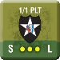 | 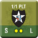 |  | |
| US-1-2-SQUAD | 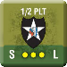 |  |  | |
| US-1-3-SQUAD | 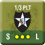 | 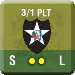 |  | |
| US-2-1-SQUAD | 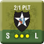 | 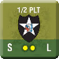 |  | |
| US-2-2-SQUAD | 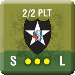 |  |  | |
| US-2-3-SQUAD | 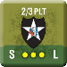 | 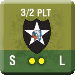 |  | |
| US-3-1-SQUAD | 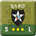 |  | none | |
| US-3-2-SQUAD | 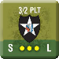 |  | none | |
| US-3-3-SQUAD | 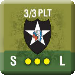 |  | none | |
| Japanese-106MM-B | no front found |  | none | |
| German-1-80-SQUAD | 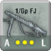 |  | none | |
| German-GE-FJ-5GP-SQUAD | 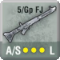 |  | none | |
| German-GE-GR-4GP-SQUAD | 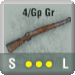 |  | none | |
| German-GE-HMG-2-WEAPONS_TEAM |  |  | none | |
| German-GE-HMG-3-WEAPONS_TEAM | 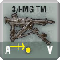 |  | none | |

## Notes

- **Alternate** faces are all squads with a 2-step `AL` image and VOF A. Mark Y only if it is a true flip.
- **Japanese-106MM-B** has no front, so it can't be paired until a front is found.
