# Step-down chains: full visual, with options

Read each row left to right: a counter steps down through the columns until it reaches a fire team. The last two columns are the **1-step options**: a squad can convert to either a Fire Team or an Assault Team (rulebook 6.5). Images link to `api/img/fof/counters`. Compare each row with the same unit in VASSAL.

## 1. 2nd Inf Div (Normandy)

Order is the grid you gave: platoon/squad, down the squad columns 1, 2, 3.

| Chain | 3 steps | 2 steps | Fire option | Assault option |
|---|---|---|---|---|
| 1/1 | 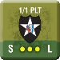 `2nd_1-1.png` | 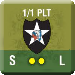 `2nd_1-1b.png` |  `LAT_Fire Team-W.png` |  `LAT_Assault Team-W.png` |
| 2/1 | 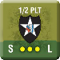 `2nd_1-2.png` |  `2nd_1-2b.png` |  `LAT_Fire Team-W.png` |  `LAT_Assault Team-W.png` |
| 3/1 | 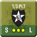 `2nd_1-3.png` |  `2nd_3-1b.png` |  `LAT_Fire Team-W.png` |  `LAT_Assault Team-W.png` |
| 1/2 | 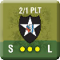 `2nd_2-1.png` | **No 2-step linked yet.** Config has none for 1/2. Confirm in VASSAL. | — | — |
| 2/2 | 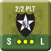 `2nd_2-2.png` |  `2nd_2-2b.png` |  `LAT_Fire Team-W.png` |  `LAT_Assault Team-W.png` |
| 3/2 | 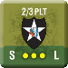 `2nd_2-3.png` |  `2nd_3-2b.png` |  `LAT_Fire Team-W.png` |  `LAT_Assault Team-W.png` |
| 1/3 | 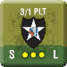 `2nd_3-1.png` | 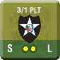 `2nd_1-3b.png` |  `LAT_Fire Team-W.png` |  `LAT_Assault Team-W.png` |
| 2/3 | 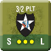 `2nd_3-2.png` | 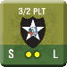 `2nd_2-3b.png` |  `LAT_Fire Team-W.png` |  `LAT_Assault Team-W.png` |
| 3/3 | 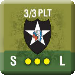 `2nd_3-3.png` |  `2nd_3-3b.png` |  `LAT_Fire Team-W.png` |  `LAT_Assault Team-W.png` |

## 2. 1st Marine Div

| Chain | 4 steps | 3 steps | 2 steps | Fire option | Assault option |
|---|---|---|---|---|---|
| 1/1 |  `1_1 4 step.png` |  `1_1 3 step.png` |  `1_1 2 step.png` |  `LAT_Fire Team-W.png` |  `LAT_Assault Team-W.png` |
| 2/1 |  `1_2 4 step.png` |  `1_2 3 step.png` |  `1_2 2 step.png` |  `LAT_Fire Team-W.png` |  `LAT_Assault Team-W.png` |
| 3/1 |  `1_3 4 step.png` |  `1_3 3 step.png` |  `1_3 2 step.png` |  `LAT_Fire Team-W.png` |  `LAT_Assault Team-W.png` |

## 3. 101st Airborne

Ratings: the 3-step and 2-step faces are now **A** at Line experience. The `AL` faces are airborne pieces and are not linked.

| Chain (platoon/squad) | 3 steps | 2 steps | Fire option | Assault option |
|---|---|---|---|---|
| 1/1 |  `1-1 3 step.png` |  `1-1 2 step.png` |  `LAT_Fire Team-W.png` |  `LAT_Assault Team-W.png` |
| 1/2 |  `2-1 3 step.png` |  `2-1 2 step.png` |  `LAT_Fire Team-W.png` |  `LAT_Assault Team-W.png` |
| 2/1 |  `1-2 3 step.png` |  `1-2 2 step.png` |  `LAT_Fire Team-W.png` |  `LAT_Assault Team-W.png` |
| 2/2 |  `2-2 3 step.png` |  `2-2 2 step.png` |  `LAT_Fire Team-W.png` |  `LAT_Assault Team-W.png` |
| 3/1 |  `1-3 3 step.png` |  `1-3 2 step.png` |  `LAT_Fire Team-W.png` |  `LAT_Assault Team-W.png` |
| 3/2 |  `2-3 3 step.png` |  `2-3 2 step.png` |  `LAT_Fire Team-W.png` |  `LAT_Assault Team-W.png` |

## 4. Other units

| Unit | Step chain | Fire option | Assault option |
|---|---|---|---|
| 25th Engineers | 3 steps 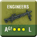 `25th_Engineers.png` → 2 steps 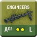 `25th_Engineersb.png` → 1 step |  `25th_Engineers Fireteam AC.png` |  `LAT_Assault Team-W.png` |
| 60mm mortar |  `1_Mtr 60mm.png` →  `1_Mtr 60mm b.png` | — (no fire option) | — |

## Items to check in VASSAL

- **2/1 2-step:** `2nd_1-2b.png`, as you specified. Done.
- **1/3 pairing:** `2nd_3-1.png` (platoon 1, squad 3) steps down to `2nd_1-3b.png`, as you confirmed. Done.

## Open data questions

| Question | Image | File | Current answer |
|---|---|---|---|
| 101st rating |  | `1-1 3 step.png` | Changed to A at both steps. |
| 25th Engineers rating |  | `25th_Engineers.png` | A is correct for both steps. |
| Mortar rating |  | `1_Mtr 60mm.png` | G! is correct. |
