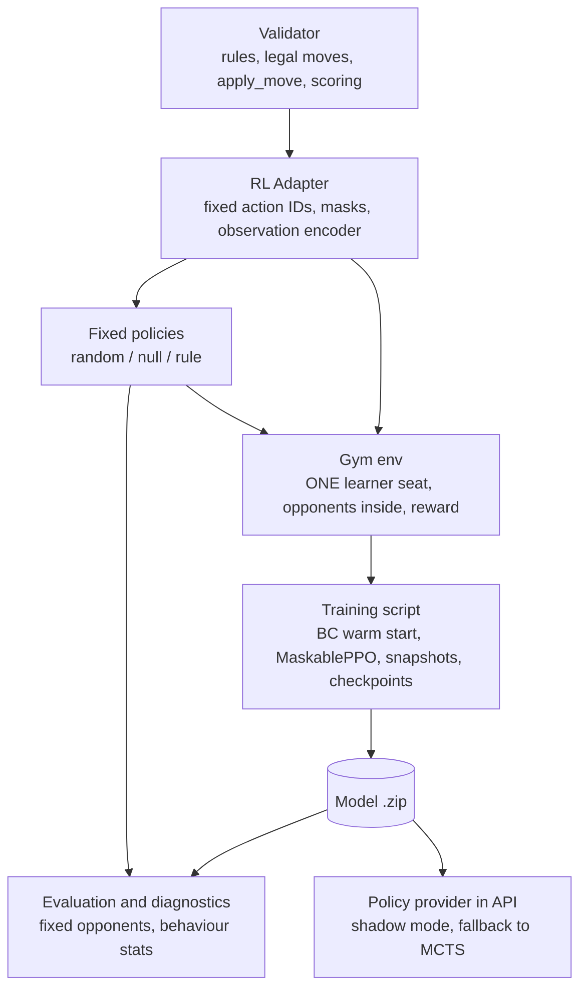

# RL Game AI Playbook: From Rules to a Strong Trained Model

> **Audience:** any engineer or LLM building a reinforcement-learning (RL) AI for
> a game in this repository. **Start here.** This playbook is game-agnostic. Lost
> Cities is the worked example, because it is the first game where this process
> produced a model stronger than a hand-written rule policy.
>
> **Companion documents:**
> - [game-requirements-analysis.md](game-requirements-analysis.md) — the rules, state, and API for the game.
> - [board-game-ai-analysis.md](board-game-ai-analysis.md) — the decision model and what each player can see.
> - [game-implementation-guide.md](game-implementation-guide.md) — lifecycle and required playable-game gate.
> - [game-ai-implementation-guide.md](game-ai-implementation-guide.md) — the separate search-based path; search is optional, not required before RL.
> - [lost-cities-rl-adapter-plan.md](lost-cities-rl-adapter-plan.md) — chronological Lost Cities experiment record; historical provider statements are dated.
> - [Bus RL analysis](Bus/bus-rl-analysis.md) — implemented Bus adapter/environment/training/evaluation and caveats. [Bus PPO readiness](Bus/bus-ppo-readiness.md) is a superseded pre-implementation snapshot.
>
> **Lifecycle:** Begin this playbook only after the game passes the rules-correct
> playable gate in [game-implementation-guide.md](game-implementation-guide.md#game-lifecycle-from-idea-to-playable-game). RL is optional; it does not replace validator, persistence, UI, or human-play acceptance.

---

## 0. TL;DR — the eleven rules that matter most

1. **Measure baselines before you train.** Write a "do nothing" policy, a random
   policy, and a ~40-line rule policy. A model that cannot beat "do nothing" has
   learned nothing, whatever its training curves look like.
2. **Train one seat against opponents that live inside the environment.** Never
   feed two players' moves into a single-agent learner. It mixes up whose reward
   is whose, and the value function learns noise.
3. **Reward the change in score margin after every learner turn.** Use a running
   score that includes points not yet banked. The rewards add up exactly to the
   final margin, so this shaping is safe.
4. **Give the model the facts a good player looks at.** Raw state is not enough.
   Pre-compute relations: "is this card playable", "the gap to my last card",
   "unseen higher cards", "does this help my opponent".
5. **Make observations canonical.** Sort hands, rotate the board to the player's
   point of view, and order entities consistently. The network must not have to
   learn that slot order is meaningless.
6. **Never leak hidden information.** Observations contain only what that player
   could legally know.
7. **Warm-start with behaviour cloning** from the rule policy, then fine-tune with
   PPO. This saves a lot of training time and gives a sensible starting point.
8. **Use rollouts that contain whole games:** `n_steps × n_envs` should be several
   full games. Run vectorised environments.
9. **Evaluate against fixed opponents, swapping seats, on held-out seeds, with
   enough games.** Self-play win rates are meaningless as a strength measure.
   Choose the best checkpoint by held-out score, not the last one saved.
10. **Diagnose with behaviour statistics, not loss curves.** Compare per-round
    behaviour, value-vs-outcome correlation, the permutation test, and the
    action distribution against the baselines. The gap tells you what to fix.
11. **Expose rule-critical derived values directly.** A model may technically
    infer a maximum, minimum, affordability, remaining quota, or global
    constraint from raw entity features, but that does not ensure reliable
    computation. If experts and the validator repeatedly use such a value,
    consider encoding it explicitly, version the schema, and evaluate the
    feature change before promoting a newly trained model. Bus encodes each
    player's buses; an explicit global maximum-buses scalar is a possible future
    observation improvement, not a claim that current inference already has it
    precomputed.

---

## 1. Why this playbook exists (the Lost Cities lesson)

The first Lost Cities PPO models trained for 100k–500k steps. Their logs looked
healthy: episodes got shorter and reward went up. Every one of them scored
**below a policy that never plays a card** (0 points per game):

| Policy | Score/game | Notes |
| --- | --- | --- |
| never play | 0 | the floor |
| rule policy (~40 lines) | +46 | the bar to beat |
| old PPO 100k | −72 | 1.1 expeditions/round, nearly all of them losing |
| random | −103 | |
| existing validator heuristic | −108 | worse than random! |
| old PPO 500k | −145 to −187 | opened 4–5 losing expeditions per round |

The cause was not too little training. Three structural problems were to blame:

| Root cause | Symptom that revealed it |
| --- | --- |
| Both players' moves went into one single-agent stream, so rewards and the bootstrapped value came from the wrong point of view | Value predictions flat (std 0.01–0.06), value-vs-outcome correlation ≈ 0, explained variance ≤ 0 |
| Hand encoded by slot position, unsorted, with no "playable" feature | After shuffling the hand, the model picked the same card only 10–14% of the time (chance is 12.5%) |
| Score feedback only at round end, plus shaping bonuses that rewarded both players equally | The model learned only what the shaping paid for (end games fast), not how to score |
| Every training episode reused the same deal (seeding bug) | Discovered by code reading. Always test that `reset()` produces different deals. |

After the redesign described in this playbook (one seat, dense margin reward,
relational features, sorted hands, BC warm start, vectorised PPO), results were:

| Model | Score/game vs rule | Rule's score | Win rate vs rule |
| --- | --- | --- | --- |
| Behaviour clone only | +33 | +43 | 42% |
| PPO 100k | +84 | +60 | 63% |
| PPO 1M (historical baseline) | +122.6 | +82.1 | 69% |
| **PPO lower-LR 2M (current PPO selection)** | **+173.0** | **+70.6** | **90.5%** |
| PPO 1M vs random | +170 | −217 | 100% |

The historical PPO selection is the 2,015,232-timestep lower-learning-rate
fine-tune, confirmed against the matched 1M baseline on held-out seed 777 with
200 games per starting seat. Its mean score margin was +102.49 versus +40.56
for the baseline. These figures describe that experiment and do not establish
the current live provider default, which is recorded separately in §14.
See the experiment record for per-seat metrics.

The rest of this document generalises what made the difference.

---

## 2. When to use RL (and when not to)

| Use RL when | Prefer MCTS/search or rules when |
| --- | --- |
| The game is long or stochastic, so search depth is limited | The game is short, deterministic, and has perfect information |
| Hidden information makes search expensive (determinization) | The game has a cheap, accurate evaluator |
| You can simulate millions of moves cheaply (≥ 300 steps/s per core) | Each simulated move is expensive |
| Strategy is "feel"-based (when to commit, when to wait) | A small set of hand-written rules is already near optimal |
| You want a fast inference-time policy (one forward pass) | You need explainable move choices |

RL and search combine well. A trained policy can provide priors for MCTS, and a
value head can evaluate the positions where search stops. Build the RL policy
behind the same policy-provider boundary used by MCTS (see §14).

### Multi-player public-information games

PPO does not require a PettingZoo environment. This repository's SB3 setup uses
Gymnasium and trains one learner seat while the environment advances the other
players internally. For a 3–5 player game, rotate the learner to a canonical
seat, encode opponents in a stable relative order, and evaluate with swapped
learner seats and fixed opponents. Use PettingZoo only if multi-agent API
interoperability is itself a requirement. Before training, ensure the
validator's mandatory actions and maximum-completion rules cannot be bypassed;
otherwise the policy will learn against an invalid game.

---

## 3. Architecture: the layers and who owns what



| Layer | Lost Cities file | Owns | Must NOT do |
| --- | --- | --- | --- |
| Validator | `api/app/games/<game>/validator.py` | Rules, legality, transitions, scoring | Know about RL |
| Adapter contract | [api/app/core/rl_adapter.py](../api/app/core/rl_adapter.py) | Generic `RLAdapter` protocol (no ML deps) | Import Gymnasium/torch |
| Game adapter | [api/app/games/lost_cities/rl_adapter.py](../api/app/games/lost_cities/rl_adapter.py) | Action ID ↔ move mapping, mask, observation encoding, canonical ordering | Leak hidden info; contain reward shaping |
| Fixed policies | [api/app/games/lost_cities/rl_policies.py](../api/app/games/lost_cities/rl_policies.py) | Random, null, and rule baselines; model/seat selector helpers | Be tuned against the model |
| Gym env | [api/app/games/lost_cities/gym_env.py](../api/app/games/lost_cities/gym_env.py) | One-seat episodes, opponent pool, reward, seeding | Let the learner see opponent decisions as its own |
| Training | [api/scripts/train_lost_cities_ppo.py](../api/scripts/train_lost_cities_ppo.py) | BC, PPO, snapshots, checkpoints | Hard-code reward constants (expose them as CLI flags) |
| Evaluation | [api/scripts/evaluate_lost_cities_model.py](../api/scripts/evaluate_lost_cities_model.py) | Head-to-head scores and win rates | Use self-play as a strength claim |
| Diagnostics | [api/scripts/diagnose_lost_cities_policies.py](../api/scripts/diagnose_lost_cities_policies.py) | Behaviour statistics, value calibration, baseline table | Be skipped |
| Tests | `api/tests/test_<game>_rl_*.py`, `test_<game>_gym_env.py` | Contracts in §13 | — |

**Library stack (do not change without a strong reason):** Gymnasium,
`stable-baselines3` and `sb3-contrib` (`MaskablePPO`), and PyTorch, installed
through the `rl` extra in `api/pyproject.toml`. Behaviour cloning is plain
PyTorch on top of the SB3 policy, so it needs no extra library.

---

## 4. Step 1 — Analyse the game for RL

Before writing code, answer each of these in writing, in the game's
`documentation/<Game>/` folder. Every answer feeds a design decision later.

| Question | Why it matters | Lost Cities answer |
| --- | --- | --- |
| How many players? Fixed or variable? | One-seat env design; reward for 3+ players | 2 |
| What is a *decision*? Are there phases within a turn? | Action space; one env step per decision | 2 phases: play/discard, then draw |
| How many legal actions per decision (min/avg/max)? | Fixed action space size, masking | ≤ 16 play/discard, ≤ 6 draw |
| What can each player see? | Observation visibility, leakage tests | Own hand, all expeditions, discard tops. NOT opponent hand or deck order |
| When do points change? Banked versus provisional? | Running-score definition for dense reward | Banked at round end; expedition value is computable any time |
| Is the game zero-sum? Is the margin meaningful or only win/loss? | Reward = margin, or win/loss | Margin is meaningful (multi-round totals) |
| Typical game length in decisions | `n_steps`, `gamma`, `max_episode_steps` | 3 rounds; ≈280–340 env steps per game in diagnostics |
| Stochastic elements? | Seeding, evaluation sample size | Shuffled deck |
| Irreversible commitments? | Key features (cost of starting), behaviour stats | Starting an expedition costs 20 points |
| Can the game stall or loop? | Truncation, timeout penalty | Yes: discard-draw cycles |
| What does an expert look at before each move? | **Feature list (§6)** | Playability, gaps, unseen higher cards, opponent's needs, cards left |
| Symmetries? | Canonical ordering, data augmentation | Colours are symmetric; hand order is irrelevant |

The last two rows matter most. **Write down how a strong human evaluates a
move.** Every item on that list should become a pre-computed feature.

---

## 5. Step 2 — Design the action space

### 5.1 Fixed action IDs with masks

PPO needs a fixed `Discrete(N)` action space. Map every possible decision to a
stable integer ID. Supply a boolean mask of the IDs that are legal now.
`MaskablePPO` will never sample a masked action.

Lost Cities (22 IDs):

| IDs | Meaning |
| --- | --- |
| 0–7 | Play the card in hand slot *i* to its expedition |
| 8–15 | Discard the card in hand slot *i* |
| 16 | Draw from the draw pile |
| 17–21 | Draw from discard pile of colour *c* |

### 5.2 Design rules

- **Each ID must mean the same thing every time, given the canonical
  observation.** Slot-based IDs are fine only if the hand is canonically sorted
  (§6.3). Otherwise "slot 3" means a different card each time.
- **Prefer IDs that point at entities the observation describes in the same
  order.** Then the network can line up "features of slot *i*" with "action *i*".
- **Split compound moves into sequential sub-decisions** when the cross-product
  is too large. For example, choose a piece, then a destination, or choose an
  action type, then a target. Each sub-decision is one env step with its own mask.
  The observation must show which sub-decision is pending (a phase one-hot plus
  the partial choice).
- **Large board games:** encode as `from_square × direction` or
  `from_square × to_square`, and mask. Thousands of IDs work with masking. Make
  sure the observation has per-square features in the same indexing.
- **Variable player counts:** keep the action space independent of the player
  count. Use the maximum, and mask what doesn't apply.
- **Round-trip invariant:** `action_id_for_move(move)` and
  `moves_by_action_id(...)` must be exact inverses over all legal moves. Test this
  on thousands of random states.
- **Mask invariant:** `mask[i] is True` ⇔ some legal move maps to ID `i`. Never
  allow a masked-in action that the validator rejects.

### 5.3 Terminal and opponent-turn masks

When the episode ends, return an all-false mask. SB3 never samples from it, but
the observation must still be well-formed (see §8.3).

---

## 6. Step 3 — Design the observation (the biggest lever)

> In Lost Cities, the observation redesign plus hand sorting changed the
> permutation-test result from chance to consistent card selection. It also took
> explained variance from ≤ 0 to about 0.85. **Spend most of your design time
> here.**

### 6.1 Principles

1. **Player-relative.** Always encode "me" first, then opponents in turn order
   starting from me. Rotate or flip the board so "my side" is always the same
   side. Never use absolute seat identity as a feature unless the seat really
   changes the rules.
2. **No hidden-information leakage.** Build the encoder only from data the
   player can see. "Unseen" counts must be derived from the player's own
   knowledge: everything minus own hand, minus public cards. They must never come
   from the true deck or the opponent's hand. **Write a test** that changes the
   opponent's hidden hand and the deck order and asserts the observation does not
   change.
3. **Pre-compute relations; don't make the network discover them.** A small MLP
   is bad at "compare feature A at position *i* with feature B at position
   *colour(i)*". Do that comparison in Python and hand over the answer.
4. **Canonical ordering.** Sort unordered collections (hands, piles, sets of
   units) by a deterministic key, and apply the same order to the action IDs.
5. **Normalise everything** to roughly `[-1, 1]` or `[0, 1]`: divide counts by
   their maximum and scores by a typical range. Unbounded raw scores destabilise
   training. Declare the Gym observation space with `low=-inf, high=inf` if
   values can be negative. Do not claim `[0, 1]` when it isn't true.
6. **Remove constant features.** A feature that is always 1 (for example "is
   current player" when you only observe on your own turn) wastes capacity.
7. **Version the schema.** Keep `OBSERVATION_SCHEMA_VERSION` and a
   `{version: size}` map. Infer the version from a saved model's input size, so
   old models keep loading (see `observation_version_for_size` in
   [rl_policies.py](../api/app/games/lost_cities/rl_policies.py)).

### 6.2 Feature families to include (game-agnostic checklist)

Use this as a checklist for each new game. Lost Cities' v2 encoding
(`_encode_v2` in [rl_adapter.py](../api/app/games/lost_cities/rl_adapter.py))
has 8 hand slots × 16 features, 5 colours × 23 features, and 9 globals, for 252
in total.

**Per actionable entity** (each card in hand, each unit or piece, each action slot):

| Feature | Lost Cities example | Generalisation |
| --- | --- | --- |
| Present / empty | slot occupied | slot validity |
| Identity one-hot | colour one-hot, investment flag | type, owner, kind |
| Magnitude | value / 10 | strength, cost, value |
| **Legal right now** | playable on my expedition | can move, can afford, can attack |
| **Immediate effect of acting** | play delta: score change if played | material/score change, resources gained |
| **Distance to ideal** | gap to my last card | moves to goal, tempo lost, wasted value |
| **Commitment state** | my expedition already started | already invested in this plan |
| **Opponent interaction** | opponent started this colour; opponent can use this card | does this help, block, or threaten an opponent |
| **Future potential** | unseen higher cards of this colour | remaining upside, outs, draws to complete |
| **Synergy with my other holdings** | same-colour count in hand | set/combination progress |

**Per group or region** (colour, suit, board region, resource type, route):

| Feature | Lost Cities example |
| --- | --- |
| My progress (count, multipliers, last value, current score) | expedition count, investments, last card, score |
| Same for each opponent | opponent's expedition stats |
| Unseen supply (count, sum, high cards) | unseen count / sum / investments / above my last |
| My resources applicable to it | hand count, playable sum, projected score |
| Shared or public pile state | discard top value, is investment, pile size, playable for me / for opponent |

**Global:**

| Feature | Lost Cities example |
| --- | --- |
| Phase / sub-decision one-hot | play phase vs draw phase |
| Time remaining | draw pile size (cards left = turns left) |
| Round / stage one-hot | round 1/2/3 |
| Banked score for me and each opponent | banked scores / 200 |
| Provisional (unbanked) score for each | board value / 100 |

### 6.3 Canonical ordering example

```python
def hand_sort_key(card):
    return (COLOR_INDEX[color(card)], 0 if is_investment(card) else 1, value(card))

# Applied inside the adapter after reset() and after every step(),
# so observation slot i and action IDs i / 8+i always refer to the same card.
```

### 6.4 Observation tests to write

- Size equals `OBSERVATION_SIZES[version]` for every reachable state.
- No NaN/inf; values are inside the expected ranges.
- **Invariance:** permuting the raw hand gives an identical observation after sorting.
- **Leakage:** changing hidden information gives an identical observation.
- **Semantics:** hand-built fixtures check that the "playable", "gap", and
  "unseen" features equal hand-computed values.
- **Legacy:** older schema versions still encode at their old size.

---

## 7. Step 4 — Build baseline policies first

Write these before any training. They are the opponents, the BC teacher, and the
measuring stick. Put them in `rl_policies.py` as selectors with the signature
`(adapter, observation, rng) -> action_id`.

| Policy | Purpose | How to write it |
| --- | --- | --- |
| `random` | Sanity floor; exploration opponent | Uniform over masked-in IDs |
| `null` (Lost Cities: `never_play`) | **The "do nothing" floor.** In many games doing nothing scores 0 while bad play is negative | Always choose the most passive legal action |
| `rule` | **The bar to beat**, BC teacher, main training opponent | ~40–100 lines encoding the expert's checklist from §4 |
| existing heuristic (if any) | Check whether it is actually good | Wrap it — it may be worse than random (it was in Lost Cities) |

**Writing a good rule policy** (Lost Cities `choose_rule` is the template):

1. Continue existing commitments when the step is cheap (small gap).
2. Start new commitments only when the hand supports them strongly *and* there
   is enough time left.
3. Discard or give up what is dead to you and useless to the opponent.
4. Take public resources only when they extend something you are already doing.
5. Otherwise take the safe default.

Run all baselines through the diagnostics script (§11) and record their table.
**If your rule policy does not clearly beat random and null, fix it first.** A
weak teacher gives a weak warm start.

---

## 8. Step 5 — Build the one-seat training environment

### 8.1 Why one seat

SB3 is a single-agent library. If a single-agent env alternates between players:

- Each reward belongs to whoever just moved, but GAE mixes consecutive steps
  from different players.
- The value of the next state is from the *opponent's* point of view, without a
  sign flip.
- The terminal reward reaches only the last mover.

The value function then cannot learn, and the policy learns only from shaping
that pays both players equally. **Never do this.**

### 8.2 The pattern

```python
class GameGymEnv(gym.Env):
    def reset(self, *, seed=None, options=None):
        if seed is None and not self._seeded:     # seed ONCE
            seed = self.seed_value
        super().reset(seed=seed)
        self._seeded = True
        episode_seed = int(self.np_random.integers(0, 2**31 - 1))   # new deal every episode
        self.learner = self.fixed_seat or random_seat(self.np_random)
        self.adapter.starting_player = random_seat(self.np_random)
        self._choose_opponent()                       # rule / random / snapshot by weight
        obs = self.adapter.reset(episode_seed)
        self._last_running = {p: 0.0 for p in players}
        obs = self._play_opponents_until_learner_turn(obs)
        return vector(obs), {"player_id": self.learner, "opponent": self.opponent_kind}

    def step(self, action):
        obs, _, done, info = self.adapter.step(action)          # learner move
        if not done:
            obs, done, _ = self._play_opponents_until_learner_turn(obs)
        if done or self.adapter.current_player != self.learner:
            obs = self.adapter.observe(self.learner, [])       # learner's view, empty mask
        reward, breakdown = self._margin_reward()               # §9
        truncated = not done and self.steps >= self.max_episode_steps
        ...
```

See `LostCitiesGymEnv` in [gym_env.py](../api/app/games/lost_cities/gym_env.py)
for the full implementation.

### 8.3 Non-negotiable details

| Detail | Why |
| --- | --- |
| Seed only on the first reset; draw later deals from `self.np_random` | SB3 auto-resets. Re-seeding with a fixed seed means **training on one deal forever** |
| Randomise learner seat *and* starting player | The model must play every position |
| Terminal and truncated observations are from the learner's point of view | They are used to bootstrap the value at truncation |
| `terminated` (game over) vs `truncated` (step cap) | PPO bootstraps through truncation, not through termination |
| `max_episode_steps` well above normal length (~5× typical) | Catches stalls without cutting real games |
| `action_masks()` method on the env | Required by `MaskablePPO` |
| `info` includes `final_scores`, `winner`, `reward_breakdown`, `reward_totals`, `opponent` | Needed for diagnostics and spotting reward hacking |

### 8.4 Opponent pool

`opponents = {"rule": 0.6, "random": 0.1, "snapshot": 0.3}` (Lost Cities default):

- **rule** — a strong, consistent opponent; the main signal.
- **random** — keeps the model robust to odd play. Keep it small: it is easy to
  beat and teaches little.
- **snapshot** — frozen copies of the learner, saved during training and played
  with `deterministic=False`. Self-play diversity stops the model over-fitting
  to the rule policy's habits. Load snapshots lazily on CPU and keep only the
  last *k* (`max_snapshots=5`).
- Require at least one fixed opponent with positive weight. Snapshots don't
  exist at step 0.

### 8.5 More than two players (for example Bus, 3–5 players)

- The learner still occupies **one** seat. All other seats are played inside the
  env by sampled opponents, which may differ per seat.
- Randomise the player count each episode if the game supports a range. Include
  the player count in the observation.
- Order the observation as "me" first, then opponents in turn order relative to
  me.
- Reward options (§9.4): own Δ minus mean of opponents' Δ (smooth), or own Δ
  minus best opponent's Δ (closer to "win").

---

## 9. Step 6 — Design the reward

### 9.1 The default: dense running-score margin

```text
running(p) = banked_score(p) + provisional_score(p)      # provisional = value of the board if scored now
reward_t   = scale * [ Δrunning(learner) − w * Δrunning(opponent) ]
```

- `Δ` is measured from the learner's previous decision to now. It includes
  everything the opponents did in between.
- Over a whole episode the rewards add up exactly to
  `scale × (final_margin)`, because `running` starts at 0 and ends at the
  final score. **The shaping cannot change which final outcome is best.** It
  only moves credit earlier. This is a form of potential-based shaping.
- Lost Cities: `scale = 0.01` (typical margins are ±100, so returns stay near
  ±1), `w = 1.0`.
- **Edge case:** if the game banks points *and* keeps the board at game end
  (Lost Cities' final round), `running` must count only banked points once
  `game_over` is set, or the last round is counted twice. Write a test that
  `sum(rewards) == scale × final margin` for every opponent type.

### 9.2 Optional terms (off by default)

| Term | When to use | Risk |
| --- | --- | --- |
| `win_reward` (± on terminal) | Win rate matters more than margin | Can encourage overly risky play to scrape a win |
| `timeout_penalty` (on truncation) | Games can stall | Must be smaller than typical margin rewards |
| `opponent_score_weight < 1` | Encourage own scoring in early training | Model ignores defence |

### 9.3 Reward anti-patterns (all seen in this repo)

| Anti-pattern | What happened |
| --- | --- |
| Shaping that pays both players equally (draw-pile progress, per-step cost) | It was the only learnable signal, so the model learned "end games fast" and nothing about scoring |
| Terminal-only reward to the last mover | Half the games gave the learner no outcome signal |
| Reward clipped per round (±0.2) | Big wins and small wins looked the same |
| Heuristic bonuses for "good-looking" moves | The model optimises the heuristic, not the game |

### 9.4 Games without a running score

- **Win/loss only (for example Checkers):** use `Φ(state)` = a cheap, sensible
  evaluation (material balance, mobility), normalised. Reward `Φ(s') − Φ(s)`
  plus a terminal ±1. Because shaping by a *difference of potentials* adds up to
  `Φ(final) − Φ(initial)`, it does not change which outcome is best. Keep
  `Φ(terminal) = 0`, or keep it small relative to the terminal reward.
- **Multi-player ranking:** reward = Δ(own − mean of others) during play, plus a
  terminal bonus for placing (for example +1 for 1st, scaled down to −1 for
  last).
- **Hidden scoring (secret objectives):** compute `running` only from the
  learner's own knowledge for the learner's *own* score. Use the true values for
  the reward (the reward may use hidden info; the observation may not).

### 9.5 Reward tests

- Sum of rewards equals `scale × final margin` (plus terms) for each opponent type.
- `reward_breakdown` keys sum to `reward`.
- Truncation applies the timeout term exactly once.

---

## 10. Step 7 — Training

### 10.1 Behaviour cloning warm start (strongly recommended)

`collect_teacher_data` and `behavior_clone` in
[train_lost_cities_ppo.py](../api/scripts/train_lost_cities_ppo.py):

1. Play the teacher (the rule policy) in the learner seat inside the *same*
   env, with the same opponent mix and the same observation encoder. Record
   `(obs, mask, action, discounted return)`.
2. Train the SB3 policy directly:
   `loss = −log π(a|s, mask) + 0.5 × MSE(V(s), return)`, using
   `policy.evaluate_actions(obs, actions, action_masks=masks)`.
3. Save `<output>-pretrained.zip`, then continue with PPO on the same model
   object.

| Setting | Lost Cities | Guidance |
| --- | --- | --- |
| Teacher episodes | 2,000 (290k decisions) | 20 is enough for a smoke test; ≥ 1,000 for real runs |
| Epochs | 15 | Stop when accuracy plateaus |
| Final accuracy | 0.94 | < 0.7 → the observation is missing what the teacher uses (a diagnostic in itself!) |

**BC accuracy is a free observation-quality test.** If the network cannot
imitate a 40-line rule policy, the features don't contain what the rule
looks at. Fix the features, not the network.

Training the value head during BC matters too. It makes explained variance
positive from the first PPO update, which stabilises fine-tuning.

### 10.2 PPO settings

| Parameter | Value used | Rule of thumb |
| --- | --- | --- |
| `n_envs` | 8 (`subproc` for long runs) | Number of CPU cores. Use `dummy` for smoke tests/debugging |
| `n_steps` (per env) | 1024 | `n_steps × n_envs` ≥ 20–50 full games of learner decisions |
| `batch_size` | 512 | Must divide `n_steps × n_envs` |
| `n_epochs` | 10 | Lower it (4–5) if `approx_kl` is consistently > 0.03 |
| `learning_rate` | 3e-4 | Lower to 1e-4 if fine-tuning after BC collapses performance |
| `gamma` | 0.995 | Effective horizon ≈ 1/(1−γ) = 200 decisions; keep it on the order of a round or game |
| `gae_lambda` | 0.95 | Standard |
| `ent_coef` | 0.01 | Raise if entropy collapses early; lower if play stays random |
| `net_arch` | `256,256` | Scale up with the observation size. 64×64 was too small |
| `snapshot-frequency` | 50,000 | ~5–20 snapshots per run |
| `checkpoint-frequency` | 100,000 | ≥ 10 checkpoints per run, for selection |

Expect about 550–700 env steps/s with 8 subprocess envs for a Python validator.
At that speed, 1M steps takes about 30 minutes.

### 10.3 Command template

```powershell
Push-Location api
& "c:/PROGRAM FILES/PYENV-WIN/versions/3.13/python.exe" scripts/train_<game>_ppo.py `
  --timesteps 1000000 --n-envs 8 --vec-env subproc `
  --checkpoint-frequency 100000 --pretrain-episodes 2000 --pretrain-epochs 15 `
  --output runtime/<game>-v1-1m
Pop-Location
```

**Always do a smoke run first** (16k steps, 4 envs, 20 BC episodes). It should
finish in under a minute and prove the whole pipeline works: BC prints
accuracy, PPO logs show explained variance, and snapshots and checkpoints appear
on disk.

Output files: `<output>-pretrained.zip`, `<output>.zip`,
`<output>-checkpoints/<name>_<N>_steps.zip`, and `<output>-opponents/`.

**PowerShell note:** stdout is block-buffered when piped through
`Select-String`. Monitor long runs by watching the checkpoint files, not the
console.

### 10.4 Reading training logs

| Metric | Healthy | Unhealthy → meaning |
| --- | --- | --- |
| `explained_variance` | 0.6–0.9 and stable | ≤ 0 → value cannot predict returns: perspective bug, missing features, or noisy reward |
| `ep_rew_mean` | Noisy but above the BC level | Noisy by nature with a mixed opponent pool. **Do not use it to select models** |
| `approx_kl` | 0.005–0.03 | > 0.05 repeatedly → lower LR / epochs |
| `clip_fraction` | 0.05–0.2 | > 0.3 → updates too aggressive |
| `entropy_loss` | Slowly rising toward 0 (less negative) | Rapid collapse → over-confident early; raise `ent_coef` |
| `ep_len_mean` | Near the natural game length | Rising toward the cap → stalling or loop exploit |
| FPS | Steady | Dropping → snapshot loading or memory growth |

---

## 11. Step 8 — Evaluate properly

### 11.1 Protocol

1. **Opponents:** the fixed `rule`, `random`, and `null` policies, plus the
   previous best model. Never use self-play win rate as a strength claim.
2. **Seats:** run each starting seat separately (player 1 starts / player 2
   starts) and report both. Asymmetric results reveal seat bias.
3. **Seeds:** use a held-out seed (Lost Cities used `--seed 777`) not used in
   training or checkpoint screening.
4. **Sample size:** screen with 50 games per seat; confirm with ≥ 200 per seat.
   - Score standard error ≈ `sd / √n`. For example, a per-game sd of 50
     with n = 200 gives ±3.5 points. Measure the sd for your game.
   - Win-rate 95% CI ≈ `±1.96 √(p(1−p)/n)`. With p = 0.69 and n = 400,
     that is ±4.5 percentage points.
5. **Report** own score, opponent score, margin, win rate, games finished vs
   truncated, and average length.

### 11.2 Commands (Lost Cities)

```powershell
# Baseline table (run once per game, re-run after rule-policy changes)
python scripts/diagnose_lost_cities_policies.py --episodes 50

# Checkpoint screening vs rule
python scripts/diagnose_lost_cities_policies.py --skip-baselines --opponent rule --episodes 50 `
  --model ck500k=runtime/lc-v2-1m-checkpoints/lc-v2-1m_500000_steps.zip `
  --model final=runtime/lc-v2-1m.zip

# Held-out confirmation
python scripts/diagnose_lost_cities_policies.py --skip-baselines --opponent rule --episodes 200 --seed 777 `
  --model final=runtime/lc-v2-1m.zip
```

### 11.3 Checkpoint selection

- Screen **every** checkpoint, and pick the best 2–3 by held-out margin.
- Confirm the best ones with ≥ 200 games per seat on a fresh seed.
- The last checkpoint is often, but not always, the best. Lost Cities improved
  steadily to 1M. Continuing the same run to 2M peaked at 1.1M (within noise of
  1M) and then *declined* (held-out margin +22.6 at 1.3M). Earlier experiments
  with broken rewards regressed after 100k.
- **Promote a new checkpoint only if it beats the current model by more than
  noise.** The Lost Cities 1.1M checkpoint was +4 margin better, which is about
  one standard error, so the 1M model was kept.
- Record the full table in the game's experiment log (for Lost Cities,
  [lost-cities-rl-adapter-plan.md](lost-cities-rl-adapter-plan.md)).

### 11.4 Promotion gates (before any production use)

These are recommended defaults. Tighten or relax them per game, and record the decision.

| Gate | Threshold |
| --- | --- |
| Beats `null` | Own score > 0 (or > the null policy's score) with CI not overlapping |
| Beats `rule` | Win rate > 55% and positive margin over ≥ 400 held-out games |
| Beats previous model | Head-to-head win rate > 52% over ≥ 400 games |
| Legality | 0 illegal actions; 0 crashes; ≤ 1% truncations |
| Seat symmetry | Score difference between seats within 2 standard errors |
| Latency | Inference < 50 ms per move on CPU |

---

## 12. Step 9 — Diagnose: where to improve the AI

**This is the most important skill in this playbook.** Loss curves tell you the
optimiser is running. Behaviour statistics tell you *what the model does wrong*.

### 12.1 Build a diagnostics script for every game

Model it on
[diagnose_lost_cities_policies.py](../api/scripts/diagnose_lost_cities_policies.py).
For every policy (baselines and models) it should report:

1. **Outcome:** own score, opponent score, win rate, games finished, length.
2. **Per-round / per-phase behaviour counts**, game-specific but always covering:
   - commitments started (Lost Cities: expeditions started per round)
   - commitments that lost value (negative expeditions and their total)
   - average depth of commitments (cards per expedition)
   - late commitments (started with little time left)
   - passive actions (discards), public-resource actions (discard draws)
   - loops (discard-then-redraw cycles)
3. **Value calibration:** correlation between `V(s)` and the final margin;
   mean and std of `V`.
4. **Permutation test** (for any unordered input): shuffle the entity order and
   check the model chooses the *same entity*. Agreement near 1/N (chance) means
   the model is reading positions, not content.
5. **Action distribution:** histogram of action IDs and action types.

### 12.2 Compare against the baselines, not in isolation

Put the model's row next to `null`, `random`, and `rule`. The **difference
between the model and the rule policy** in each behaviour column shows where to
look:

| Model vs rule | Meaning | Where to look |
| --- | --- | --- |
| Starts many more commitments that lose value | Doesn't understand commitment cost / remaining time | Features: projected score, unseen supply, time left. Reward: is the start cost visible immediately? |
| Rarely acts (close to `null`) | Learned that acting is risky; no positive signal | Dense reward; BC warm start; `ent_coef` |
| Late commitments | Doesn't see time remaining | Time-left feature; per-group "turns needed to profit" |
| Opponent scores more against it than against `rule` | Feeds the opponent (discards/gives away useful resources) | "Helps opponent" feature on discard actions; opponent's needs per group |
| Loops or long games | Exploiting a loop, or reward not discouraging stalling | Reward breakdown; timeout; loop features |
| Good score, win rate flat | Plays for margin, not for winning close games | Small `win_reward`; snapshot opponents |

### 12.3 Symptom → cause → fix table

| Symptom | Likely cause | Fix |
| --- | --- | --- |
| Model scores below `null` | Training signal broken (perspective, sparse reward, shaping dominates) | §8 one-seat env, §9 margin reward |
| Explained variance ≤ 0 | Value can't predict returns: perspective mixing, leaked or missing features | One-seat env; learner-perspective terminal obs; add features |
| Value-vs-outcome correlation ≈ 0 at evaluation | Same as above | Same |
| Permutation agreement ≈ chance | Positional encoding, unsorted entities | Canonical sort plus per-entity relational features |
| BC accuracy < 0.7 | Observation lacks what the rule uses | Add exactly the facts the rule policy reads |
| Training reward rises, held-out score falls | Reward hacking or over-fitting to one opponent | Inspect `reward_totals`; widen the opponent mix; select an earlier checkpoint |
| Performance identical across very different seeds | Seeding bug (same deal every episode) | Seed once; per-episode seed from `np_random`; test it |
| One seat much stronger | Seat not randomised, or not player-relative | Randomise seat and starter; encode "me first" |
| Many truncations | Stall/loop exploit | Timeout penalty; loop features; check the mask allows progress |
| Entropy collapses early, then plateaus | Over-confident too soon | Raise `ent_coef`; lower LR |
| Strong vs `rule`, weak vs new human tactics | Narrow opponent pool | More snapshot weight; add new rule variants as opponents |
| Margin grows, win rate stuck | Optimising average margin | Small `win_reward`; evaluate close-game behaviour |

### 12.4 Example: reading the Lost Cities diagnosis

Old 500k model vs `rule`: 5.0 expeditions started per round (rule: 1.1), 4.3
of them negative, permutation agreement 0.13, value correlation 0.05.

That reads as: it starts everything (doesn't understand commitment cost), it
doesn't know which card it is playing (positional), and its value function is
blind. Those three findings pointed straight at the three fixes: per-card
features with sorting, dense margin reward, and the one-seat env.

Final 1M model: 3.2 expeditions per round, scoring +40 per round, but the rule
opponent scores more against it (≈ 82 vs ≈ 60 against the 200k checkpoint).
The first guess was that its discards feed the opponent. **Measure a guess
before building a fix for it.** A `feeding_discards` statistic (discards the
opponent can immediately play on a started expedition) showed only 0.05 per
round, so the guess was wrong. The real change was tempo: discard-pile draws
rose from 4.3 to 12.1 per round, discard-and-redraw cycles from 0.8 to 2.0, and
games grew from 290 to 340 steps. The model stalls the deck to play more
cards (15 vs 10 per round). That also gives the opponent more turns, but the
net margin still improves. This is a legitimate tactic, not a bug, so no
feature was added.

Continuing to 2M pushed the same tactic further: about 17 discard draws per
round, about 4 expeditions per round, and the opponent's score rising to
≈ 95. Held-out margin dropped. When more training amplifies one behaviour
and evaluation falls, stop and change something else. Options are a lower
learning rate or entropy for fine-tuning, a different opponent mix, or a
feature that tells the model what the extra turns cost it.

---

## 13. Step 10 — The tweak loop

1. **Change one thing per experiment.** Name runs by schema and change, for
   example `lc-v2-1m`, `lc-v3-discardsafety-1m`.
2. **Keep the evaluation fixed:** same opponents, seeds, and episode counts.
3. **Order of operations when stuck:**
   1. Correctness: perspective, seeding, masks, leakage tests.
   2. Baselines: is the rule policy actually good?
   3. Observation: does BC reach > 0.9? Does the permutation test pass?
   4. Reward: does the sum equal the margin? Is any shaping term large relative
      to the margin?
   5. Rollout length and parallelism.
   6. Opponent mix: more snapshots, new rule variants.
   7. Network size and hyperparameters (last, not first).
   8. More timesteps (only once the curve is still rising on held-out
      evaluation). Use `--resume <model.zip>` to continue a run without
      starting over. Step counts, checkpoints, and snapshots continue from the
      saved model. Explicitly supplied `--learning-rate` and `--ent-coef`
      override those values on resume; unspecified values remain as saved.
4. **Log every experiment** in the game's experiment log: the change, command,
   checkpoint table, held-out confirmation, decision, and next hypothesis.
5. **Bump the observation schema version** whenever features change. Keep the
   old encoder so old models still evaluate.

---

## 14. Step 11 — Integrate the model into the app

> **Provider status (verify against code before changing):** Lost Cities uses the
> configured MaskablePPO path by default with MCTS fallback; the selection is
> persisted by the web UI. Bus PPO is implemented but opt-in; Bus remains on its
> existing MCTS default unless configured otherwise. These provider defaults
> are runtime policy, separate from which checkpoint won an offline experiment.
> The API response's `ai_provider` identifies the provider that actually made
> the move. Per-game model paths and environment overrides are documented in
> the game-specific analysis/experiment record; historical prose in those logs
> should not be treated as a current configuration source.

1. **Policy provider boundary.** The API's AI-move route asks the configured
   provider for a move. Provider choice is game-specific (rules, RL, search, or
   hybrid), and any default must be explicit and verified in code.
2. **Loading.** `MaskablePPO.load(path, device="cpu")` once per process, and
   cache it. Infer the observation version from
   `model.observation_space.shape[0]`.
3. **Inference.** Build the adapter observation from the *persisted* game state
   for the AI seat. Use the canonical sort. Run `model.predict(obs,
   action_masks=mask, deterministic=True)`. Map the ID back to a move with the
   adapter, and **validate with the validator before applying it**.
4. **Fallback.** On any exception, an illegal ID, or a missing model file, fall
   back to MCTS or the rule policy, and log it.
5. **Difficulty levels** come cheaply: deterministic for hard,
   `deterministic=False` for medium, rule or random mixing for easy, or an
   earlier checkpoint.
6. **Shadow mode first.** Run the model alongside the current provider, log both
   choices, and keep the current provider's move. Promote only after the gates
   in §11.4.
7. **Artifacts.** Keep selected models in a versioned location with a small
   manifest: game, schema version, training command, evaluation table, and
   date. Don't commit large checkpoint folders.

---

## 15. Testing checklist (copy into each new game's test files)

**Adapter (`test_<game>_rl_adapter.py`)**
- [ ] Action ID ↔ move round-trip for all legal moves over many random states
- [ ] Mask equals the set of legal IDs; no masked-in illegal action
- [ ] Observation size matches `OBSERVATION_SIZES` per version; no NaN/inf
- [ ] Hidden-information leakage test
- [ ] Permutation/canonical-order invariance
- [ ] Feature semantics on hand-built fixtures
- [ ] Legacy schema still encodes
- [ ] Deterministic trajectory under a fixed seed

**Policies (`test_<game>_rl_policies.py`)**
- [ ] Every fixed policy returns only masked-in actions over full games
- [ ] The rule policy beats random over N games (a cheap regression gate)
- [ ] Version inference from observation size

**Gym env (`test_<game>_gym_env.py`)**
- [ ] Passes `gymnasium.utils.env_checker` (or equivalent basic checks)
- [ ] Reward sum equals `scale × final margin` for each opponent type
- [ ] Different episodes get different deals after the first reset
- [ ] Learner seat and starting player both vary
- [ ] Learner only ever acts on its own turn; terminal obs from the learner's view
- [ ] Snapshot pool is bounded; snapshot is chosen only when registered
- [ ] Opponent-mix parsing/validation errors
- [ ] Teacher-data collection produces aligned arrays

Run the full backend suite before and after every change:
`python -m pytest -q` from `api/`.

---

## 16. New-game checklist (start to finish)

This is the **RL branch** of the lifecycle, not a mandatory checklist for every
new game. Complete the shared rules-correct playable gate in
[game-implementation-guide.md](game-implementation-guide.md#game-lifecycle-from-idea-to-playable-game)
first; if AI is unnecessary or a rules/search policy is selected instead, stop
here and use the applicable method guide.

1. [ ] Rules implemented and tested in the validator (non-RL docs complete).
2. [ ] §4 RL analysis table written in `documentation/<Game>/`.
3. [ ] Action space designed (§5) and documented as an ID table.
4. [ ] Observation v1 designed from the expert checklist (§6); schema versioned.
5. [ ] Adapter implemented in `api/app/games/<game>/rl_adapter.py` against the
       `RLAdapter` protocol, with tests.
6. [ ] `random`, `null`, and `rule` policies in `rl_policies.py`, with tests.
7. [ ] Diagnostics script; baseline table recorded.
8. [ ] One-seat Gym env with the margin reward (§8–9), with tests.
9. [ ] Training script cloned from the Lost Cities one; smoke run passes.
10. [ ] BC-only model evaluated (sanity: close to the rule policy).
11. [ ] 1M-step run; every checkpoint screened; best confirmed on a held-out seed.
12. [ ] Diagnosis vs `rule` (§12); next hypothesis written down.
13. [ ] Iterate (§13) until the promotion gates pass (§11.4).
14. [ ] Integrated behind the policy provider in shadow mode (§14).
15. [ ] `AGENTS.md`, `work-items.md`, and the experiment log updated.

---

## 17. Appendix — Minimal templates

### 17.1 Adapter skeleton

```python
OBSERVATION_SCHEMA_VERSION = 1
OBSERVATION_SIZES = {1: ...}

@dataclass
class GameReferenceEnv:                      # satisfies app.core.rl_adapter.RLAdapter
    seed: int = 42
    starting_player: str = "player_1"
    observation_version: int = OBSERVATION_SCHEMA_VERSION

    @property
    def action_count(self) -> int: ...
    @property
    def observation_size(self) -> int: return OBSERVATION_SIZES[self.observation_version]
    @property
    def current_player(self) -> str: ...

    def reset(self, seed=None):
        # validator.initial_game_data(rng_seed=...), apply starting_player, canonicalise
        return self.observe(self.current_player)

    def legal_moves(self, player_id=None): return self.validator.get_legal_moves(...)

    def observe(self, player_id, legal_moves=None):
        moves = self.legal_moves(player_id) if legal_moves is None else legal_moves
        mask = [False] * self.action_count
        for move in moves:
            mask[action_id_for_move(move)] = True
        return {"observation": encode_observation(self.state, player_id, version=self.observation_version),
                "action_mask": mask, "player_id": player_id}

    def step(self, action_id):
        move = moves_by_action_id(self.legal_moves())[action_id]
        self.state = self.validator.apply_move(self.state, move)
        self._canonicalise()
        done = self.state["game_over"]
        return self.observe(self.current_player, [] if done else None), 0.0, done, {"move": move, "winner": ...}
```

### 17.2 Rule-policy skeleton

```python
def choose_rule(adapter, observation, rng):
    state, me = adapter.state, adapter.current_player
    legal = adapter.legal_moves(me)
    # 1. cheap continuation of existing commitments
    # 2. strong new commitment if enough time remains
    # 3. safe discard/pass: dead to me AND useless to opponents
    # 4. take public resources only if they extend a commitment
    # 5. default
    return action_id_for_move(chosen)
```

### 17.3 Running-score reward

```python
def running_score(game_data, player):
    banked = game_data["scores"][player]
    if game_data.get("game_over"):
        return banked                       # avoid double-counting a final board
    return banked + provisional_score(game_data, player)
```

---

## 18. Glossary

| Term | Meaning |
| --- | --- |
| Action mask | Boolean vector marking which fixed action IDs are legal now |
| BC (behaviour cloning) | Supervised training of the policy to imitate a teacher's actions |
| Canonical ordering | Deterministic ordering of unordered collections so equal states encode identically |
| Explained variance | How well the value head predicts the returns (1 = perfect, ≤ 0 = useless) |
| Held-out seed | A random seed never used in training or screening, used to confirm results |
| Null policy | The most passive legal policy; the "do nothing" floor |
| One-seat env | Gym env where the learner controls one player and all others move inside the env |
| Permutation test | Shuffle unordered inputs and check whether the decision follows the content |
| Running score | Banked score plus the current provisional value of the player's position |
| Snapshot opponent | A frozen earlier copy of the learner used as a training opponent |
